# SmartOmni Detailed Design

# **Appendix Diagram Source Code**

The following listings are the editable PlantUML class diagram source and Mermaid sequenceDiagram source.

## **3.1 User Authentication**

### **PlantUML class diagram**

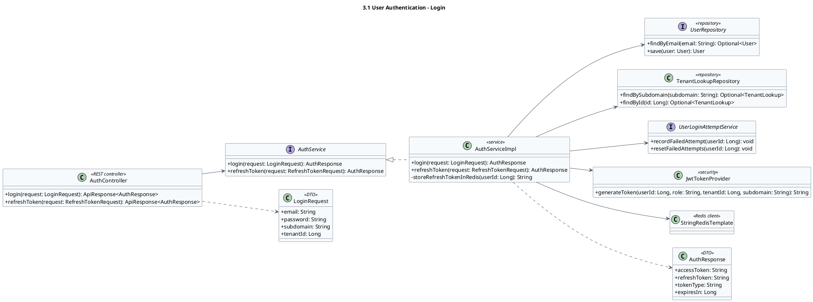

### **Mermaid sequenceDiagram**

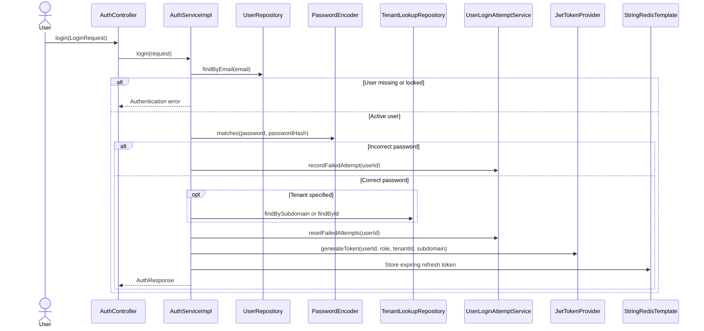

## **3.2 Tenant Onboarding and Management**

### **PlantUML class diagram**

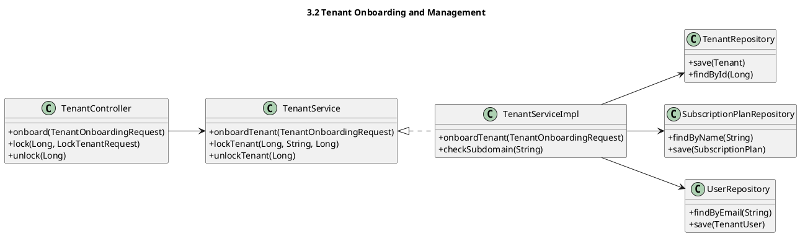

### **Mermaid sequenceDiagram**

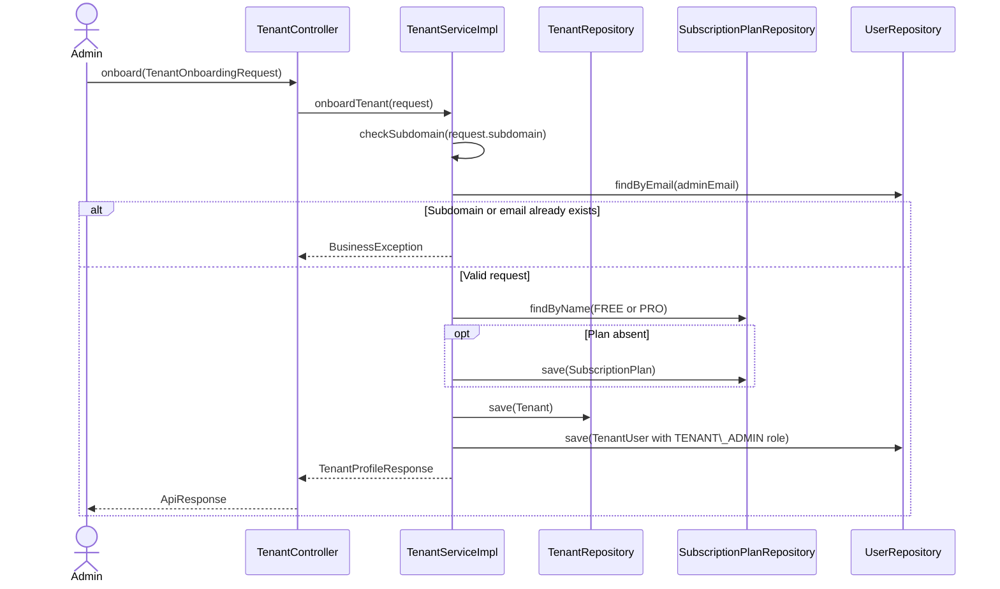

## **3.4 Marketplace Connection Management**

### **PlantUML class diagram**

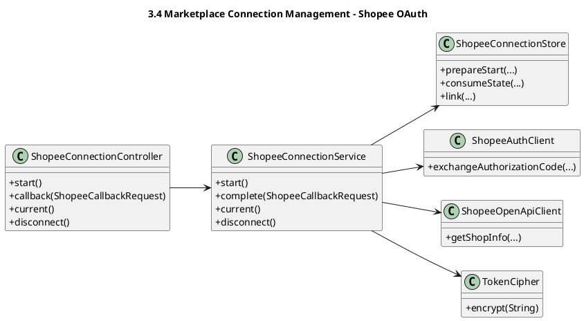

### **Mermaid sequenceDiagram**

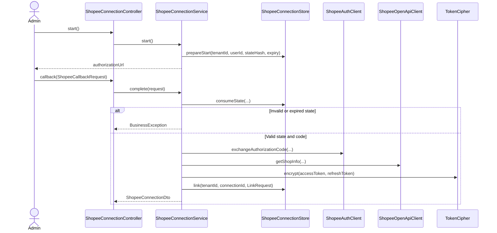

## **3.5 Product and SKU Management**

### **PlantUML class diagram**

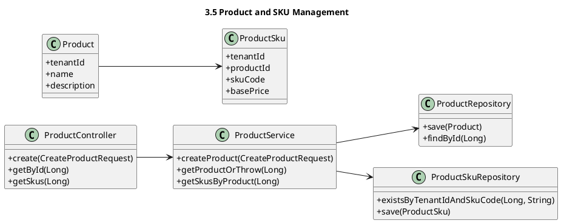

### **Mermaid sequenceDiagram**

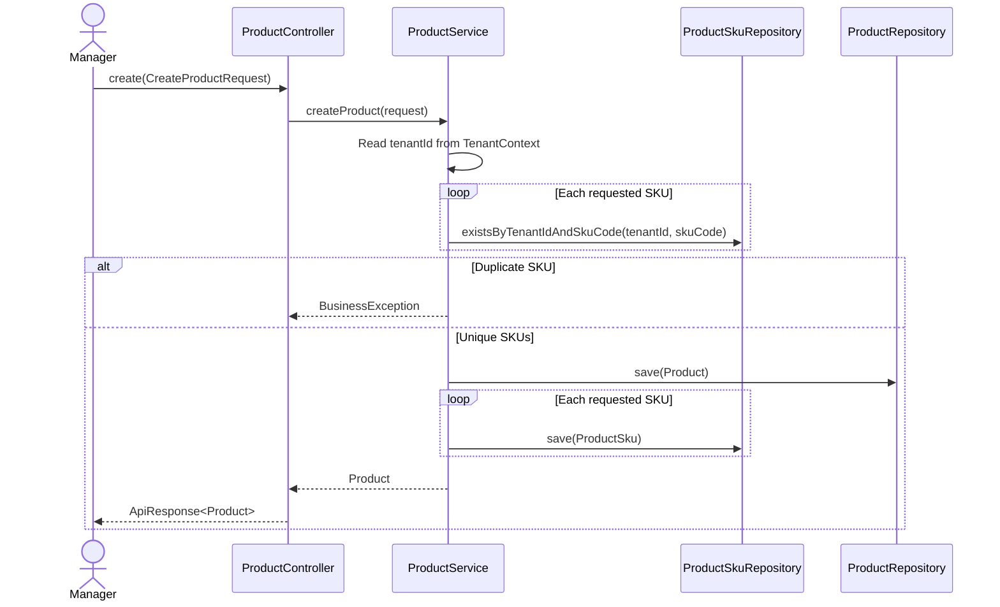

## **3.6 Marketplace Product Import and Price Sync**

### **PlantUML class diagram**

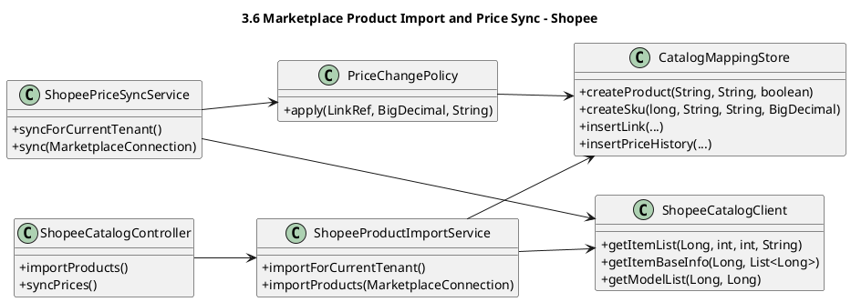

### **Mermaid sequenceDiagram**

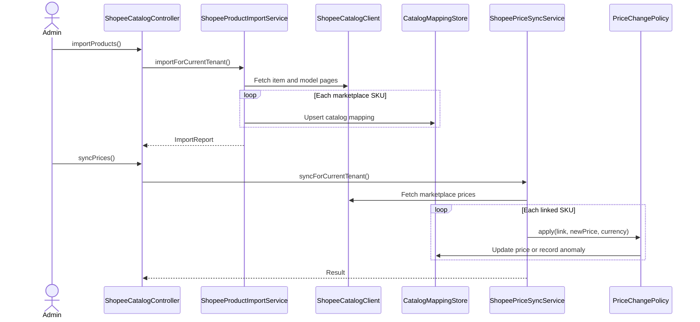

## **3.7 Inventory Management**

### **PlantUML class diagram**

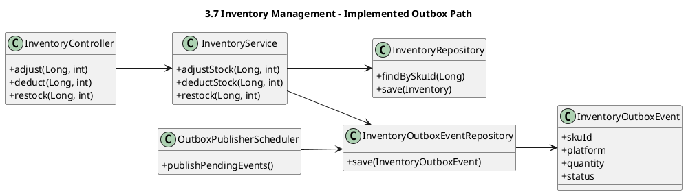

### **Mermaid sequenceDiagram**

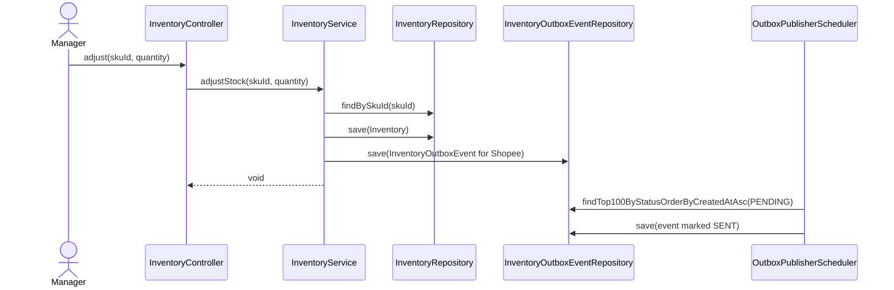

## **3.8 Order Synchronization via Webhook**

### **PlantUML class diagram**

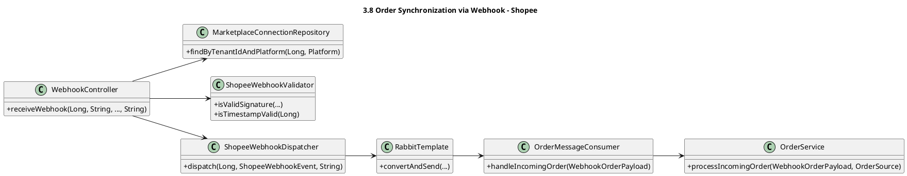

### **Mermaid sequenceDiagram**

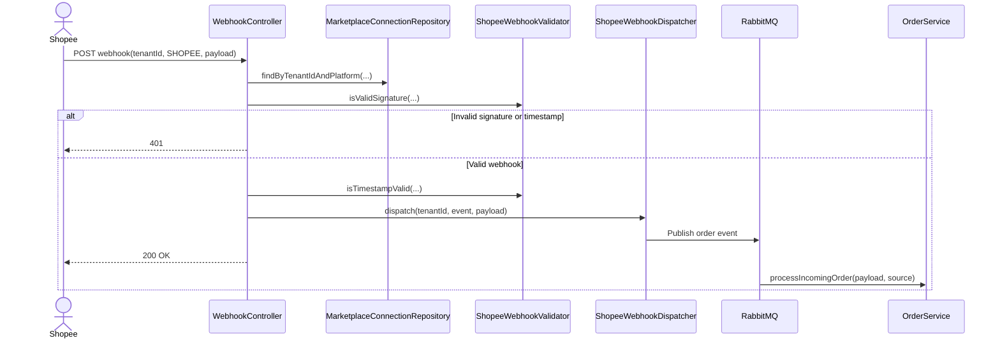

## **3.9 Order Synchronization via Polling**

### **PlantUML class diagram**

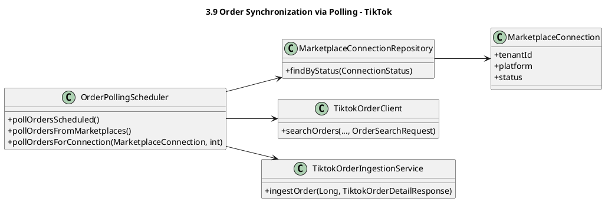

### **Mermaid sequenceDiagram**

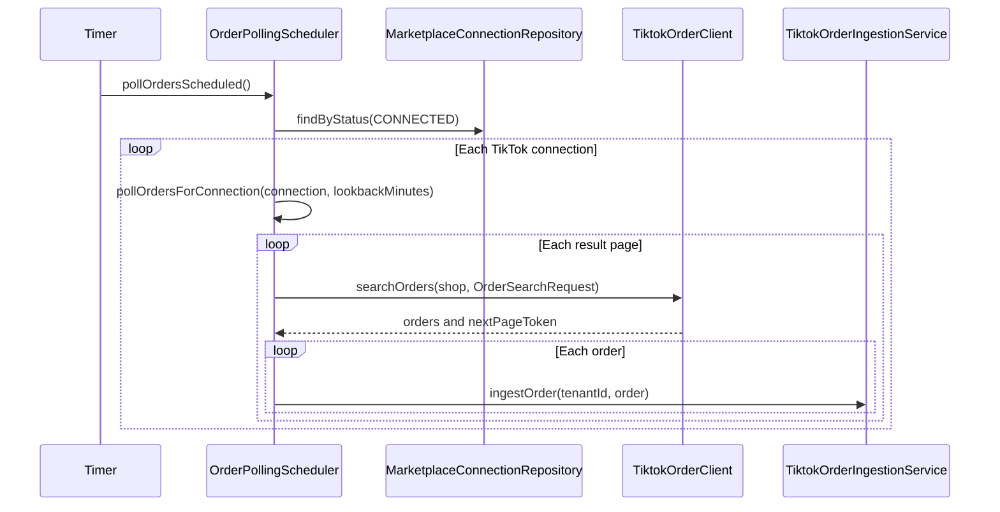

## **3.10 Order Lifecycle Management**

### **PlantUML class diagram**

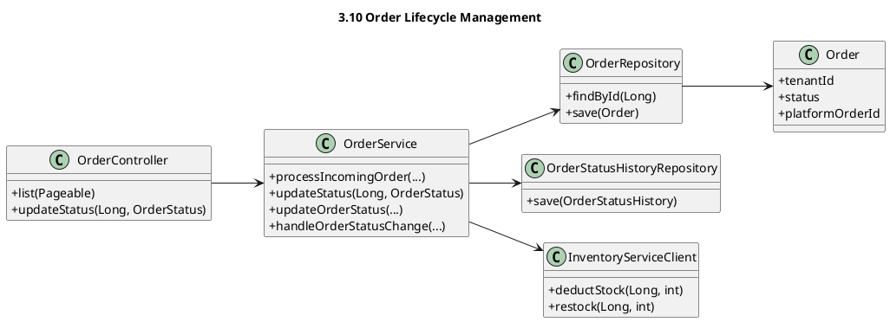

### **Mermaid sequenceDiagram**

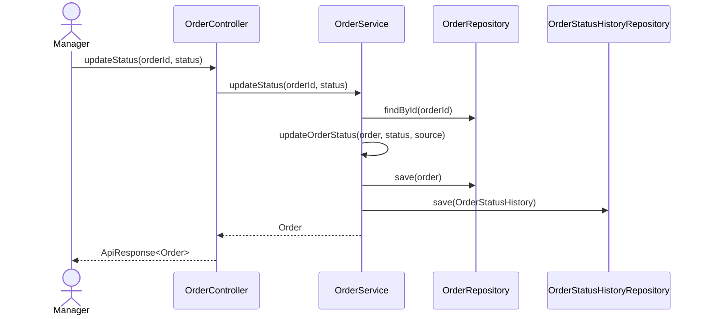

## **3.11 Shipment and Tracking Management**

### **PlantUML class diagram**

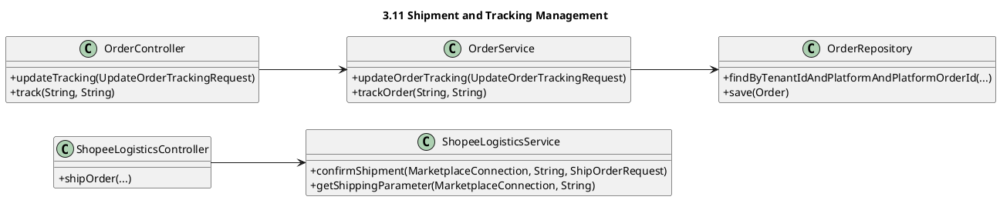

### **Mermaid sequenceDiagram**

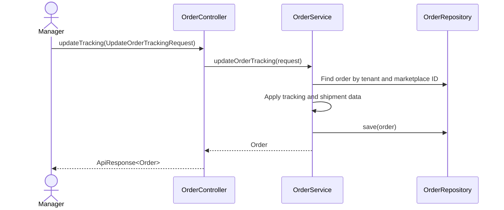

## **3.12 Return Refund and Dispute Management**

### **PlantUML class diagram**

```plantuml

@startuml
title 3.12 Return Refund and Dispute Management - Implemented Paths
skinparam backgroundColor #FFFFFF
skinparam classAttributeIconSize 0
skinparam shadowing false
left to right direction
class ReturnRefundController {
  +create(CreateReturnRequest)
  +approve(Long)
}
class ReturnRefundService {
  +createReturnRequest(CreateReturnRequest)
  +approveAndRestock(Long)
}
class ReturnRefundRepository {
  +findById(Long)
  +save(ReturnRefund)
}
class OrderRepository {
  +findById(Long)
  +save(Order)
}
class ShopeeFinanceAndReturnsController {
  +confirmReturn(String)
  +disputeReturn(...)
}
class ShopeeFinanceAndReturnsService {
  +confirmReturn(...)
  +disputeReturn(...)
}
ReturnRefundController --> ReturnRefundService
ReturnRefundService --> ReturnRefundRepository
ReturnRefundService --> OrderRepository
ShopeeFinanceAndReturnsController --> ShopeeFinanceAndReturnsService
@enduml

```

### **Mermaid sequenceDiagram**

```mermaid

sequenceDiagram
actor Manager
participant C as ReturnRefundController
participant S as ReturnRefundService
participant O as OrderRepository
participant R as ReturnRefundRepository
Manager->>C: create(CreateReturnRequest)
C->>S: createReturnRequest(request)
S->>O: findById(orderId)
S->>R: save(ReturnRefund status REQUESTED)
S-->>C: ReturnRefund
Manager->>C: approve(refundId)
C->>S: approveAndRestock(refundId)
S->>R: findById(refundId)
S->>R: save(ReturnRefund status COMPLETED)
S->>O: save(Order status RETURNED)
S-->>C: ReturnRefund

```

## **3.13 AI Demand Forecasting and Product Recommendation**

### **PlantUML class diagram**

```plantuml

@startuml
title 3.13 AI Demand Forecasting and Product Recommendation
skinparam backgroundColor #FFFFFF
skinparam classAttributeIconSize 0
skinparam shadowing false
left to right direction
class DemandForecastController {
  +runForecast()
  +getForecasts(Long)
}
class DemandForecastService {
  +runForecastForTenant(Long)
  +getForecastsForSku(Long, Long)
}
class RecommendationController {
  +getRecommendations(Long)
}
class RecommendationService {
  +getTopRecommendations(Long, Long)
  +refreshRecommendations(Long, Long)
}
class PythonAiServiceClient {
  +requestDemandForecast(Long)
  +requestRecommendations(Long, Long)
}
class DemandForecastRepository {
  +save(DemandForecast)
  +findByTenantIdAndSkuId(Long, Long)
}
class ProductRecommendationCacheRepository {
  +save(ProductRecommendationCache)
  +findTop3BySourceSkuIdOrderBySimilarityScoreDesc(Long)
}
DemandForecastController --> DemandForecastService
RecommendationController --> RecommendationService
DemandForecastService --> PythonAiServiceClient
RecommendationService --> PythonAiServiceClient
DemandForecastService --> DemandForecastRepository
RecommendationService --> ProductRecommendationCacheRepository
@enduml

```

### **Mermaid sequenceDiagram**

```mermaid

sequenceDiagram
actor Manager
participant FC as DemandForecastController
participant FS as DemandForecastService
participant RC as RecommendationController
participant RS as RecommendationService
participant Python as PythonAiServiceClient
participant DB as AI repositories
Manager->>FC: runForecast()
FC->>FS: runForecastForTenant(tenantId)
FS->>Python: requestDemandForecast(tenantId)
Python-->>FS: ForecastResultDto list
FS->>DB: Compare model RMSE and save version
opt New model is better
FS->>DB: Save DemandForecast rows
end
Manager->>RC: getRecommendations(skuId)
RC->>RS: getTopRecommendations(tenantId, skuId)
RS->>DB: Read cached top 3
opt Cache empty
RS->>Python: requestRecommendations(tenantId, skuId)
RS->>DB: Save ProductRecommendationCache rows
end
RS-->>RC: Recommendations
```
